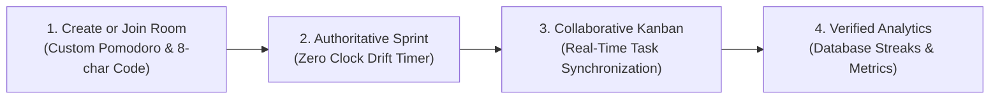

# StudyFlow — Collaborative Digital Study Environment

<p align="center">
  
</p>

> **Synchronized focus. Collaborative tasks. Zero distraction.**

[](https://www.typescriptlang.org/)
[](https://nextjs.org/)
[](https://expressjs.com/)
[](https://socket.io/)
[](https://www.postgresql.org/)
[](https://www.prisma.io/)

---

## 💡 1. The Project Idea

Modern academic and technical study often suffers from an invisible crisis: **digital isolation and fragmented attention**. When individuals study alone, procrastination and phone notifications routinely derail deep work sessions. While students frequently form virtual study groups to combat this, existing digital tools force them into disjointed workflows—using voice calls for presence, standalone timer websites for countdowns, project managers for tasks, and spreadsheets for habit logs.

**StudyFlow** solves this by establishing a unified, browser-native **Collaborative Digital Study Sanctuary**. It brings students, study circles, hackathon teams, and remote work cohorts together into shared virtual rooms governed by an **authoritative synchronized Pomodoro engine**, an **integrated collaborative Kanban board**, and **lightweight real-time presence**. 

The core philosophy of StudyFlow is simple:
- **Shared Accountability:** When everyone in a room enters a 25-minute focus sprint at the exact same millisecond, social cohesion eliminates procrastination.
- **Unified Context:** Tasks, timers, and team presence live in one distraction-free interface, preventing context switching.
- **Disciplined Flow:** Time-blocked focus intervals are interspersed with structured short and long breaks, maintaining cognitive endurance without burnout.

---

## ⚙️ 2. How It Works

StudyFlow transforms scattered study habits into a synchronized, structured rhythm through four interconnected operational pillars:



### 1. Instant Room Creation & Role Management
- A student or study group host creates a dedicated workspace (public or private) with custom interval settings (e.g., 25-min Focus, 5-min Short Break, 15-min Long Break, 4-cycle cadence).
- A unique 8-character invite code (e.g., `SD3ASTRO`) is generated. Peers join instantly across browsers without manual configuration.
- The platform enforces granular **Role-Based Access Control (RBAC)**:
  - **Room Owner & Moderators:** Authoritative control over timer states (start, pause, resume, skip phase), room settings, and member moderation.
  - **Members:** View live synchronized timers, manage collaborative task cards, and interact via real-time ephemeral chat.

### 2. Centralized Authoritative Timer Engine
- When the host clicks **"Start Focus"**, the command is dispatched to the backend server over WebSockets.
- The server acts as the **single source of truth**—recording start timestamps, phase configurations, and remaining durations in memory and relational persistence.
- The server broadcasts authoritative 1-second ticks (`timer:tick`) to all connected clients in the room namespace.
- Client browsers perform optimistic, smooth local rendering while continuously reconciling against the server timestamp. 
- **Tab & Network Resilience:** If a participant's laptop goes to sleep, a browser tab is throttled in the background, or a user refreshes the page (`F5`), the client reconnects and immediately snaps to the authoritative server clock without losing a single second.

### 3. Collaborative Kanban Board & Ephemeral Live Chat
- Inside the active session, teammates organize their work on an interactive 4-column board: **Backlog**, **To Do**, **In Progress**, and **Completed**.
- Task additions, assignments, priority shifts (`Low`, `Medium`, `High`, `Urgent`), and drag-and-drop column transitions are broadcast instantaneously (<50ms) across all peers via Socket.IO events.
- An **ephemeral Google Meet-style live chat and activity feed** streams participant joins, task completions, and session notices via an in-memory ring-buffer—providing real-time social feedback without polluting the relational database.

### 4. Automated Transitions & Data-Driven Habit Analytics
- When a focus sprint hits `00:00`, the server transitions the room state to the break phase, emits a synchronized notification, and triggers an synthesized **Web Audio harmonic completion chime** across all participants' speakers simultaneously.
- The engine automatically logs a verified `PomodoroRecord` in PostgreSQL for each active participant.
- The **Analytics Engine** dynamically analyzes verified records to produce:
  - Daily, weekly, and monthly focused minute totals.
  - True continuous study streaks (verifying at least 1 completed focus sprint per calendar day).
  - Task completion efficiency ratios and historical focus heatmaps.

---

## 🎯 3. Why Users Need It

| The Traditional Student Dilemma | The StudyFlow Solution |
| :--- | :--- |
| **The Solo Procrastination Trap:** Studying alone in silence frequently collapses into endless social media scrolling and notification checking. | **Collective Social Accountability:** Teammates work side-by-side in synchronized focus blocks. Seeing peers actively focused creates positive peer motivation. |
| **The "Clock Drift" Problem in Group Study:** When groups attempt to study together using independent timer websites, background tab throttling causes timers to desynchronize by minutes, ruining scheduled group breaks. | **Authoritative Zero-Drift Clock:** One authoritative server clock dictates the session for every participant. Everyone takes breaks and resumes deep work together in unison. |
| **Context-Switching & Tool Fatigue:** Students alternate between Discord for presence, Notion for tasks, Pomofocus for timers, and notes apps—wasting cognitive energy. | **All-in-One Distraction-Free Workspace:** Timers, task boards, participant rosters, and instant meeting notes reside in a clean, unified, dark/light interface. |
| **Distracting Voice & Video Overhead:** Platforms like Zoom, Teams, or Google Meet demand high CPU, heavy bandwidth, and visual presentation anxiety (camera readiness). | **Silent Co-Working & Ephemeral Presence:** Low-bandwidth, text-and-presence focus environment designed specifically for silent concentration without camera pressure. |
| **Inaccurate & Falsified Habit Logs:** Most habit trackers rely on manually typed estimates ("I studied 4 hours today"), leading to unearned streaks and self-deception. | **Verified Execution Analytics:** Analytics and streak counts are derived directly from verified completed Pomodoro sprints stored in the database. |

---

## 🚀 4. What Makes StudyFlow Different from Other Projects?

While timer tools, task boards, and virtual study spaces exist, StudyFlow is uniquely architected from the ground up for **synchronized group deep work**.

### Detailed Feature Comparison

| Capability / Feature | Traditional Timers<br/>*(Pomofocus, Marinara)* | Gamified Apps<br/>*(Forest, Flora)* | General Project Tools<br/>*(Trello, Notion, Linear)* | Video Platforms<br/>*(Zoom, Discord Study)* | **StudyFlow** |
| :--- | :---: | :---: | :---: | :---: | :---: |
| **Authoritative Multi-User Sync** | ❌ (Client-only) | ❌ (Isolated mobile) | ❌ (No session timer) | ❌ (Manual third-party bots) | ✅ **Authoritative Backend Master Clock** |
| **Zero Clock Drift on Tab Sleep** | ❌ (Throttled by OS) | ❌ (Device dependent) | ➖ (N/A) | ❌ (Bot lag & audio desync) | ✅ **Mathematical Server Timestamp Reconciliation** |
| **Integrated Collaborative Kanban** | ❌ (Simple flat list) | ❌ (None) | ✅ (Task only) | ❌ (No visual board) | ✅ **Live Real-Time Kanban (<50ms sync)** |
| **Single-Tab Concurrency Guard** | ❌ (None) | ➖ (N/A) | ❌ (Duplicate tabs clash) | ➖ (N/A) | ✅ **BroadcastChannel Multi-Tab Guard** |
| **Low-Bandwidth "Silent Presence"** | ➖ (Single user) | ➖ (Single user) | ❌ (Asynchronous only) | ❌ (Heavy audio/video overhead) | ✅ **Lightweight WebSocket Heartbeat Roster** |
| **Ephemeral Session Activity Stream** | ❌ (None) | ❌ (None) | ❌ (Permanent logs only) | ❌ (Persistent chat history) | ✅ **Google Meet-style In-Memory Ring Buffer** |
| **Native Zero-Asset Audio Chimes** | ❌ (Static MP3 files) | ❌ (Pre-recorded clips) | ❌ (None) | ❌ (Heavy ringtones) | ✅ **Web Audio API Pure Sine Synthesis** |
| **Speed-of-Thought Command Palette** | ❌ (None) | ❌ (None) | ⚠️ (Some tools) | ❌ (Slash commands) | ✅ **Universal ⌘K / Ctrl+K Spotlight** |
| **Enterprise-Grade Auth Security** | ❌ (Local storage) | ⚠️ (Basic OAuth) | ✅ (Session tokens) | ✅ (Platform auth) | ✅ **HTTP-Only JWT Cookies + Salted Bcrypt** |

---

### Key Architectural Differentiators

```
┌────────────────────────────────────────────────────────────────────────┐
│                        STUDYFLOW INNOVATIONS                           │
├────────────────────────────────┬───────────────────────────────────────┤
│ 1. Server-Authoritative Engine │ No client clock manipulation. Survives│
│    with Sub-50ms Broadcast     │ network disconnects & tab throttles.  │
├────────────────────────────────┼───────────────────────────────────────┤
│ 2. Ephemeral In-Memory Stream  │ Chat & activities stream via RAM ring │
│    (Google Meet Model)         │ buffer (zero DB disk bloat).          │
├────────────────────────────────┼───────────────────────────────────────┤
│ 3. Single-Tab Guard via        │ Detects duplicate room tabs via       │
│    BroadcastChannel API        │ browser IPC; prevents audio clash.    │
├────────────────────────────────┼───────────────────────────────────────┤
│ 4. Algorithmic Study Streaks   │ Traverses verified completed focus    │
│    from Relational Records     │ cycles day-by-day (anti-cheat).       │
├────────────────────────────────┼───────────────────────────────────────┤
│ 5. Synthesized Web Audio       │ Harmonic chimes generated purely via  │
│    Harmonic Oscillators        │ mathematics; 0 KB asset footprint.    │
└────────────────────────────────┴───────────────────────────────────────┘
```

1. **True Authoritative Multi-Client Synchronization:**  
   Most web timers run a naive JavaScript `setInterval` in the client's browser. When browser tabs lose focus, modern operating systems down-throttle JS timers to conserve battery, causing timers on different machines to drift by minutes. In StudyFlow, the client never dictates the remaining time. The backend continuously calculates remaining duration using authoritative server timestamps ($R(t) = R_{saved} - \lfloor \frac{t_{current} - t_{started}}{1000} \rfloor$) and broadcasts real-time ticks.
2. **Ephemeral Activity Streaming (Zero Database Bloat):**  
   Standard collaborative apps write every chat message, member entry, and minor status change into a SQL database. StudyFlow uses a dual-tier storage strategy: mission-critical data (users, rooms, tasks, completed focus analytics) is persisted in **PostgreSQL 16 via Prisma**, while high-frequency room interactions (live chat, member join notifications, timer alerts) stream through an **in-memory ring-buffer in Node.js** and disappear when the room closes—just like Google Meet.
3. **Single-Tab Concurrency Guard:**  
   Opening multiple browser tabs to the same real-time workspace normally leads to duplicate WebSocket handshakes, double audio chimes, and desynchronized local stores. StudyFlow implements a native `BroadcastChannel` protocol that detects duplicate tabs and presents an instant modal: *"StudyFlow is open in another tab"*, ensuring each participant maintains exactly one active socket connection.
4. **Pure Client-Side Web Audio Synthesis:**  
   Rather than loading heavy external `.mp3` or `.wav` sound files that fail to load on high-latency connections, StudyFlow uses the **Web Audio API** to dynamically synthesize pure melodic sine-wave chimes (C5 $\to$ G5 $\to$ C6 harmonic chord) directly in the browser's audio context with zero network overhead.
5. **Speed-of-Thought Spotlight Command Palette (⌘K):**  
   Designed with engineering and academic workflows in mind, users can navigate rooms, toggle timers, search tasks, switch themes, and jump across views using a fully accessible keyboard palette without lifting their fingers from the keyboard.

---

## 📚 Project Documentation & References

Comprehensive technical specifications, schema references, and academic defense documentation are available in the `docs/` directory:

- 🏗️ **[Technical Architecture Documentation](docs/TECHNICAL_ARCHITECTURE.md):** In-depth technical breakdown of the full-stack architecture, Socket.IO gateway, drift-correction algorithms, memory management, and security protocols.
- 🗄️ **[Database Schema & ER Diagram](docs/SCHEMA_DIAGRAM.md):** Complete PostgreSQL relational schema, Mermaid entity-relationship diagram, indexing strategies, and data dictionary.
- 🎓 **[Academic Defense Documentation](docs/ACADEMIC_DEFENSE.md):** Formal project presentation manual, course defense demonstration scripts, theoretical formulations, and examiner viva Q&A.

---

## 👥 Engineering Team & Academic Attribution

StudyFlow was designed and engineered by **Group Astro**:
- **Md. Asraful Islam Furdus** — Lead Full-Stack Architect
- **Md Shakil Mia** — Collaborator

*Developed for Academic Course: SD3 — Web Development (ECSE).*
