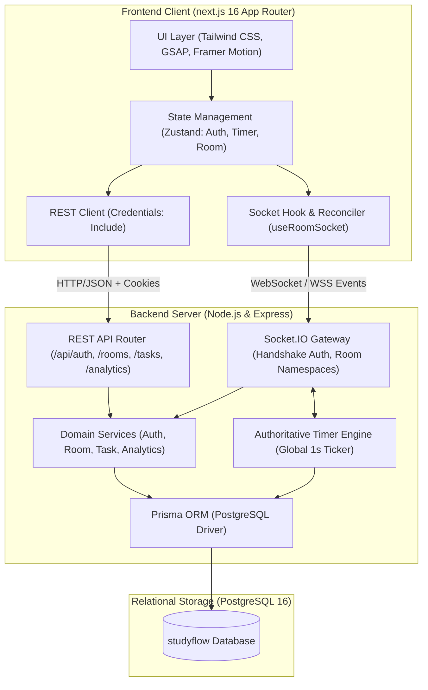
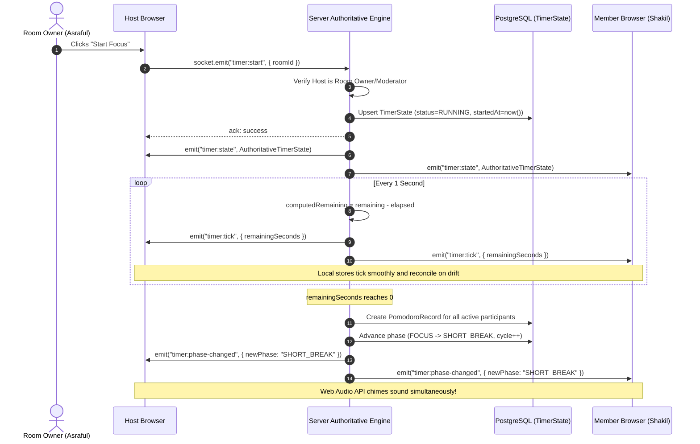
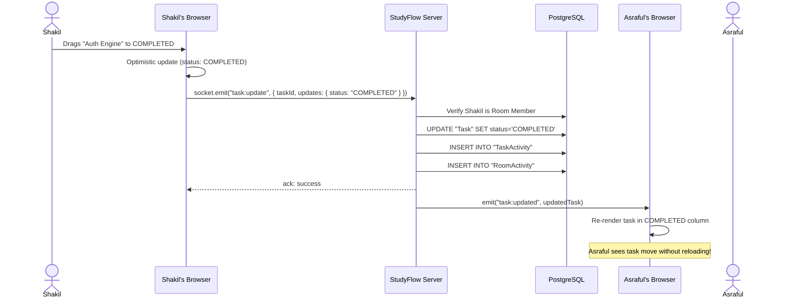
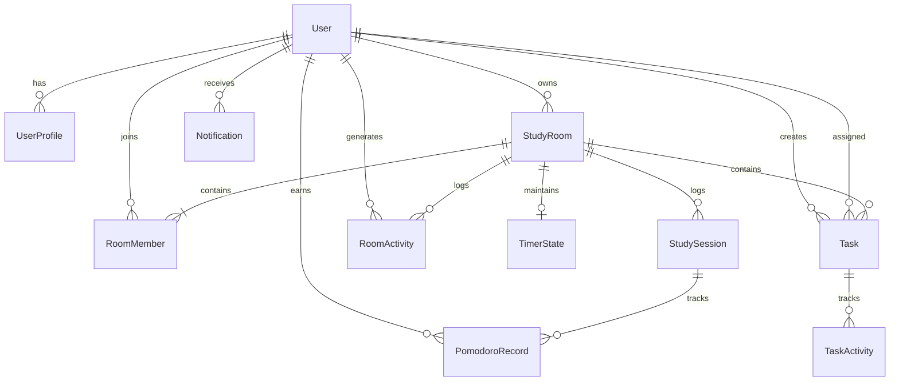

# StudyFlow — Academic Defense & Technical Architecture Documentation

**Course:** SD3 — Web Development  
**Group:** Astro  
**Program:** ECSE (Electronics & Communication / Computer Science Engineering)  
**Section:** D  

**Team Members:**
- **Md. Asraful Islam Furdus**
- **Md Shakil Mia**

**Approved Academic Project:**  
*A web-based platform for group Pomodoro sessions and collaborative task tracking.*

---

## 1. System Architecture Overview

StudyFlow is designed around a decoupled, monorepo architecture utilizing **npm workspaces**. It enforces a strict separation of concerns between client rendering, shared domain models, relational database persistence, and authoritative real-time state synchronization.



### Monorepo Structure

```
studyflow/
├── apps/
│   ├── web/                     # next.js 16 App Router frontend
│   │   ├── app/                 # Routes: landing, dashboard, rooms, tasks, analytics, settings
│   │   ├── components/          # Reusable UI, PomodoroTimer, TaskBoard, ParticipantList
│   │   ├── hooks/               # useRoomSocket, useAuth
│   │   ├── lib/                 # api.ts, socket.ts, audio.ts (Web Audio chime)
│   │   └── stores/              # Zustand stores: authStore, roomStore, timerStore
│   └── server/                  # Node.js + Express backend
│       └── src/
│           ├── config/          # Environment & Prisma client
│           ├── controllers/     # HTTP endpoint handlers
│           ├── middleware/      # JWT auth, Zod validation, error handler
│           ├── routes/          # Express REST routers
│           ├── services/        # Business logic & Authoritative Timer Engine
│           ├── sockets/         # Socket.IO event gateway
│           ├── shared/          # Shared contracts, types, & constants
│           └── __tests__/       # Automated unit, integration & concurrency tests
│       └── prisma/
│           ├── schema.prisma    # Normalized PostgreSQL relational schema
│           └── seed.ts          # Realistic test accounts, rooms, tasks, and historical records
└── docs/
    └── ACADEMIC_DEFENSE.md      # This comprehensive technical defense manual
```

---

## 2. Frontend & Backend Communication Strategy

StudyFlow uses a **hybrid communication model**:

1. **REST API (Stateless Operations):** Used for user authentication, profile modifications, room bootstrapping, and aggregation queries (e.g. historical analytics).
2. **WebSockets via Socket.IO (Stateful Real-Time Synchronization):** Used for instant group timer state broadcasts, collaborative task manipulations, presence tracking, and room activity streams.

### Protocol Comparison in StudyFlow

| Concern | REST API | Socket.IO WebSockets |
| :--- | :--- | :--- |
| **Authentication** | HTTP-only `access_token` JWT cookie | Cookie parsed during handshake + bearer fallback |
| **Primary Use Cases** | Login, registration, analytics aggregates | Group Pomodoro timer, task CRUD broadcasts |
| **Connection Overhead** | Independent HTTP requests | Persistent, full-duplex TCP connection |
| **Data Flow** | Unidirectional request-response | Bidirectional push notifications |
| **Drift Handling** | N/A | Periodic authoritative tick sync + local prediction |

---

## 3. Authoritative Group Pomodoro Synchronization

### The Problem with Client-Side Timers in Group Productivity
If each client ran an independent `setInterval` countdown locally, network latency, browser tab throttling (background tab timer slowdown), and clock drift would cause different students to see different remaining times within minutes. Furthermore, browser refreshes would wipe out session progress.

### The Authoritative Solution
The server is the **single source of truth**. No client ever dictates how much time remains.



### Mathematical Formulation of Remaining Time
At any point in time $t_{current}$, the authoritative remaining duration $R(t)$ is defined as:

$$R(t) = \begin{cases} 
R_{saved} & \text{if } \text{status} = \text{PAUSED} \\
\max\left(0, R_{saved} - \lfloor \frac{t_{current} - t_{started}}{1000} \rfloor\right) & \text{if } \text{status} = \text{RUNNING} \\
D_{total} & \text{if } \text{status} = \text{IDLE}
\end{cases}$$

Where:
- $R_{saved}$ is the stored remaining seconds when the session began or was last paused.
- $t_{started}$ is the server timestamp when the timer was started or resumed.
- $D_{total}$ is the total duration configured for the current phase (e.g. 1500 seconds for 25 minutes).

### Crash & Restart Resilience
Because `startedAt`, `remainingSeconds`, and `status` are persisted in the PostgreSQL `TimerState` record, if the backend process crashes or restarts:
1. `TimerService.initializeFromDatabase()` executes on startup.
2. It queries all timers with `status = RUNNING`.
3. It computes elapsed time during the downtime. If time expired, it completes the phase and stores Pomodoro records; if time remains, it resumes the tick loop seamlessly.

---

## 4. Multi-User Concurrency & Collaborative Task Board

### Concurrency Strategy
When multiple users work on the task board simultaneously:
1. **Optimistic Updates:** The client immediately applies the user's action locally for instant UI feedback.
2. **Server Broadcast:** The action is validated and persisted in PostgreSQL, then broadcast to all members in the room via `task:created`, `task:updated`, or `task:deleted`.
3. **Rollback on Failure:** If the user lacked permission (e.g., trying to delete another user's task without moderator privileges), the server responds with `room:error` and the client rolls back the optimistic change.



---

## 5. Database Schema & Relational Design

The database schema is fully normalized in PostgreSQL and managed with Prisma ORM.



### Relational Schema Summary:
1. **`User`**: Core identity (UUID, email, passwordHash, name, avatar).
2. **`UserProfile`**: User preferences (daily focus targets, sound toggle, theme).
3. **`StudyRoom`**: Collaborative workspace settings, unique 8-character invite code (`SD3ASTRO`), Pomodoro cycle durations.
4. **`RoomMember`**: Composite unique relation `(roomId, userId)` with roles (`OWNER`, `MODERATOR`, `MEMBER`).
5. **`TimerState`**: Persisted authoritative timer state linked 1:1 to `StudyRoom`.
6. **`StudySession`**: Historical study session tracking total minutes and completed cycles.
7. **`PomodoroRecord`**: Relational record created upon successful completion of a 25-minute focus session.
8. **`Task`**: Shared task cards categorized by status (`BACKLOG`, `TODO`, `IN_PROGRESS`, `COMPLETED`) and priority (`LOW`, `MEDIUM`, `HIGH`, `URGENT`).
9. **`TaskActivity` & `RoomActivity`**: Audit trail of every action taken in the room.

---

## 6. Authentication & Security Architecture

1. **Password Security:** Salted and hashed using `bcrypt` (10 rounds). Raw passwords are never stored or logged.
2. **Session Storage:** Signed JSON Web Tokens (JWT) stored in **HTTP-only, SameSite=Lax** cookies. This protects tokens against Cross-Site Scripting (XSS) attacks.
3. **Role-Based Access Control (RBAC):**
   - **`OWNER`**: Edit room details, delete room, modify durations, start/pause/skip timer, assign moderator roles, remove members.
   - **`MODERATOR`**: Start/pause/skip timer, create tasks, move/delete tasks, remove members.
   - **`MEMBER`**: View synchronized timer, create tasks, edit assigned tasks, participate in room chat.
4. **Backend Authorization Enforcement:** Every socket and REST endpoint validates the authenticated `userId` against the database before executing any state change.

---

## 7. Productivity Analytics Engine

Unlike dummy dashboard templates, all metrics in StudyFlow are calculated dynamically from actual source records in the `PomodoroRecord` and `Task` tables:

1. **Today's Focus Time:** Sum of `durationMinutes` where `phase = FOCUS` and `completedAt >= startOfDay(now)`.
2. **Weekly & Monthly Focus:** Sum of `durationMinutes` filtered by calendar start of week and month.
3. **Study Streak Calculation:**
   - Extracts unique calendar days on which the user completed at least 1 focus Pomodoro session.
   - Sorts dates in descending order.
   - Validates that the most recent study day was today or yesterday.
   - Traverses backwards day-by-day to determine the exact unbroken chain of active study days.
4. **Task Completion Rate:** Calculated dynamically as $\frac{\text{Completed Tasks}}{\text{Total Assigned Tasks}} \times 100\%$.

---

## 8. Step-by-Step Academic Defense Demonstration Script

For live demonstration to the course instructor:

### Scenario 1: Multi-User Simultaneous Collaboration
1. Open **Window 1 (Chrome Incognito)** and navigate to `http://localhost:3000/login`.
   - Click the defense shortcut: **"Asraful (Host)"**.
   - Navigate to the **SD3 Project War Room** (`/rooms/[id]`).
2. Open **Window 2 (Firefox / Second Window)** and navigate to `http://localhost:3000/login`.
   - Click the defense shortcut: **"Shakil (Moderator)"**.
   - Navigate to the **SD3 Project War Room** (`/rooms/[id]`).
3. **Observe Concurrency:**
   - Notice Shakil's avatar immediately shows a green pulsing **online presence dot** in Asraful's participant list.
   - Asraful receives a real-time toast: *"Md Shakil Mia joined the room"*.

### Scenario 2: Authoritative Timer Synchronization
1. In Window 1 (Asraful), click **"Start Focus"**.
2. **Observe Synchronization:**
   - Window 1 and Window 2 immediately transition from `IDLE` to `RUNNING`.
   - The countdown (`24:59`, `24:58`...) ticks down **in perfect unison across both screens**.
   - In Window 2 (Shakil), click **"Pause"** (since Shakil is Moderator). Both windows pause on the exact same second.
   - Click **"Resume"**. Both windows resume counting down seamlessly.

### Scenario 3: Real-Time Collaborative Task Board
1. In Window 2 (Shakil), click **"Add Task"**:
   - Title: *"Demonstrate sub-50ms WebSocket broadcast"*.
   - Priority: *Urgent*. Status: *To Do*. Assignee: *Asraful*.
   - Click *Create Task*.
2. **Observe Real-Time Broadcast:**
   - Window 1 (Asraful) instantly receives the task without page refresh.
   - A toast appears: *"New task added: Demonstrate sub-50ms WebSocket broadcast"*.
3. In Window 1 (Asraful), click the right arrow to move the task to **"In Progress"** and then **"Completed"**.
   - Window 2 immediately reflects the moved card and strikethrough styling.

### Scenario 4: Disconnection & Reload Recovery
1. In Window 2 (Shakil), press **F5 (Refresh)** or close and reopen the tab.
2. **Observe Recovery:**
   - The room loads immediately with the exact authoritative time remaining.
   - The timer does not reset to 25:00; it continues counting down from the authoritative server clock.

### Scenario 5: Unauthorized Action Rejection
1. Register a new student account (Role: `MEMBER`).
2. Join the room via invite code `SD3ASTRO`.
3. Note that timer control buttons are hidden and replaced with: *"Synchronized with room host Md. Asraful Islam Furdus"*.
4. Even if an unauthorized socket event `timer:start` is emitted programmatically, the backend rejects it with `ForbiddenError: Only the room owner or moderators can control the timer`.

---

## 9. Automated Verification Test Suite

StudyFlow includes automated unit and integration tests executing with **Vitest**:

```bash
npm run test
```

### Test Coverage Summary:
- `timer.test.ts`: Verifies non-drifting mathematical countdowns, pause duration preservation, and 4-cycle Pomodoro state transitions (Focus $\to$ Short Break $\times 3 \to$ Long Break).
- `auth.test.ts`: Verifies bcrypt password hashing, JWT generation, and rejection of tampered tokens.
- `concurrency.test.ts`: Launches two independent Socket.IO client instances simultaneously, joins the same room, triggers timer starts, and asserts sub-50ms state synchronization across distinct connections.

---

**Academic Project Prepared By:** Group Astro (Md. Asraful Islam Furdus & Md Shakil Mia)  
**Submitted for:** SD3 — Web Development Academic Defense
