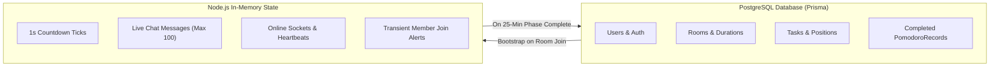

# Database Schema & Entity-Relationship Architecture — StudyFlow

> **Relational Data Modeling, Normalization, Integrity Constraints & Indexing Strategy**

---

## 1. Entity-Relationship (ER) Diagram

The following Mermaid ER diagram models all relational entities, their cardinality, primary keys, foreign keys, and structural associations defined in the Prisma schema.

```mermaid
erDiagram
    USER ||--o| USER_PROFILE : "has preferences (1:1)"
    USER ||--o{ STUDY_ROOM : "creates / owns (1:N)"
    USER ||--o{ ROOM_MEMBER : "participates in (1:N)"
    USER ||--o{ TASK : "creates (1:N)"
    USER ||--o{ TASK : "assigned to (0:N)"
    USER ||--o{ POMODORO_RECORD : "earns focus (1:N)"
    USER ||--o{ NOTIFICATION : "receives (1:N)"

    STUDY_ROOM ||--|{ ROOM_MEMBER : "contains members (1:N)"
    STUDY_ROOM ||--o| TIMER_STATE : "maintains authoritative timer (1:1)"
    STUDY_ROOM ||--o{ STUDY_SESSION : "tracks sessions (1:N)"
    STUDY_ROOM ||--o{ TASK : "manages Kanban board (1:N)"
    STUDY_ROOM ||--o{ POMODORO_RECORD : "logs focus intervals (1:N)"

    STUDY_SESSION ||--o{ TIMER_STATE : "references active timer (1:N)"
    STUDY_SESSION ||--o{ POMODORO_RECORD : "groups completed cycles (1:N)"

    USER {
        string id PK "UUID"
        string email UK "Unique email address"
        string passwordHash "Bcrypt hash (10 rounds)"
        string name "User full name"
        string avatarUrl "Optional avatar URL"
        string bio "Optional user bio"
        datetime createdAt "Creation timestamp"
        datetime updatedAt "Last modification timestamp"
    }

    USER_PROFILE {
        string id PK "UUID"
        string userId FK,UK "References USER(id) ON DELETE CASCADE"
        int dailyGoalMinutes "Target daily focus minutes (default 120)"
        string timezone "Timezone string (default UTC)"
        string themePreference "Theme: dark | light (default dark)"
        boolean soundEnabled "Audio chimes toggle (default true)"
        boolean autoStartBreaks "Auto break progression (default false)"
        boolean autoStartPomodoros "Auto focus progression (default false)"
        datetime createdAt "Creation timestamp"
        datetime updatedAt "Last modification timestamp"
    }

    STUDY_ROOM {
        string id PK "UUID"
        string name "Room display name"
        string description "Optional room description"
        string inviteCode UK "Unique 8-character code"
        boolean isPrivate "Public or Private flag"
        int focusDuration "Focus duration in seconds (default 1500)"
        int shortBreakDuration "Short break in seconds (default 300)"
        int longBreakDuration "Long break in seconds (default 900)"
        int cyclesBeforeLongBreak "Cycles count (default 4)"
        string ownerId FK "References USER(id) ON DELETE CASCADE"
        datetime createdAt "Creation timestamp"
        datetime updatedAt "Last modification timestamp"
    }

    ROOM_MEMBER {
        string id PK "UUID"
        string roomId FK "References STUDY_ROOM(id) ON DELETE CASCADE"
        string userId FK "References USER(id) ON DELETE CASCADE"
        RoomRole role "Enum: OWNER | MODERATOR | MEMBER"
        datetime joinedAt "Join timestamp"
        datetime lastActiveAt "Presence heartbeat timestamp"
    }

    STUDY_SESSION {
        string id PK "UUID"
        string roomId FK "References STUDY_ROOM(id) ON DELETE CASCADE"
        datetime startedAt "Session start timestamp"
        datetime endedAt "Session end timestamp"
        int totalDuration "Cumulative seconds elapsed"
        int completedPomodoros "Count of completed intervals"
        datetime createdAt "Creation timestamp"
        datetime updatedAt "Last modification timestamp"
    }

    TIMER_STATE {
        string id PK "UUID"
        string roomId FK,UK "References STUDY_ROOM(id) ON DELETE CASCADE"
        string sessionId FK "References STUDY_SESSION(id) ON DELETE SET NULL"
        TimerPhase phase "Enum: FOCUS | SHORT_BREAK | LONG_BREAK"
        TimerStatus status "Enum: IDLE | RUNNING | PAUSED | COMPLETED"
        datetime startedAt "Server start timestamp"
        datetime pausedAt "Server pause timestamp"
        int remainingSeconds "Authoritative seconds remaining"
        int totalPhaseDuration "Total seconds of current phase"
        int currentCycle "Current Pomodoro cycle count"
        datetime updatedAt "Last tick / state update"
    }

    POMODORO_RECORD {
        string id PK "UUID"
        string userId FK "References USER(id) ON DELETE CASCADE"
        string roomId FK "References STUDY_ROOM(id) ON DELETE SET NULL"
        string sessionId FK "References STUDY_SESSION(id) ON DELETE SET NULL"
        TimerPhase phase "Enum: FOCUS | SHORT_BREAK | LONG_BREAK"
        int durationMinutes "Completed duration in minutes"
        datetime completedAt "Completion timestamp"
    }

    TASK {
        string id PK "UUID"
        string roomId FK "References STUDY_ROOM(id) ON DELETE CASCADE"
        string title "Task title"
        string description "Optional markdown description"
        TaskStatus status "Enum: BACKLOG | TODO | IN_PROGRESS | COMPLETED"
        TaskPriority priority "Enum: LOW | MEDIUM | HIGH | URGENT"
        string assigneeId FK "References USER(id) ON DELETE SET NULL"
        string createdById FK "References USER(id) ON DELETE CASCADE"
        datetime dueDate "Optional target completion date"
        int position "Ordering index in Kanban column"
        datetime createdAt "Creation timestamp"
        datetime updatedAt "Last modification timestamp"
    }

    NOTIFICATION {
        string id PK "UUID"
        string userId FK "References USER(id) ON DELETE CASCADE"
        string title "Notification title"
        string message "Notification message content"
        NotificationType type "Enum: INFO | ROOM_INVITE | TIMER_COMPLETE | TASK_ASSIGNED"
        boolean isRead "Read status flag (default false)"
        string link "Optional redirection target"
        datetime createdAt "Creation timestamp"
    }
```

---

## 2. Comprehensive Data Dictionary & Schema Specifications

### 2.1 Enumerated Types (Enums)

| Enum Name | Possible Values | Architectural Purpose |
| :--- | :--- | :--- |
| **`RoomRole`** | `OWNER`, `MODERATOR`, `MEMBER` | Governs authorization for room management, timer control, and member moderation. |
| **`TimerPhase`** | `FOCUS`, `SHORT_BREAK`, `LONG_BREAK` | Defines the active phase of the Pomodoro interval cycle. |
| **`TimerStatus`** | `IDLE`, `RUNNING`, `PAUSED`, `COMPLETED` | Tracks the execution state of the authoritative timer engine. |
| **`TaskStatus`** | `BACKLOG`, `TODO`, `IN_PROGRESS`, `COMPLETED` | Represents Kanban board pipeline stages. |
| **`TaskPriority`** | `LOW`, `MEDIUM`, `HIGH`, `URGENT` | Visual and organizational priority indicator for tasks. |
| **`NotificationType`** | `INFO`, `ROOM_INVITE`, `TIMER_COMPLETE`, `TASK_ASSIGNED` | Categorizes user notification dispatch types. |

---

### 2.2 Table Specifications

#### 1. `User` (Core Identity)
Represents a registered user in the StudyFlow platform.
- `id` (String, UUID, Primary Key): Unique user identifier.
- `email` (String, Unique): User's primary login credential.
- `passwordHash` (String): 10-round salted bcrypt hash. Plaintext passwords are never stored.
- `name` (String): Display name of the user.
- `avatarUrl` (String, Nullable): URL to profile image.
- `bio` (String, Nullable): User bio / study focus.
- `createdAt` / `updatedAt` (DateTime): Audit timestamps.

#### 2. `UserProfile` (Preferences & Goals)
Maintains individual settings and daily focus commitments linked 1:1 with `User`.
- `id` (String, UUID, Primary Key).
- `userId` (String, Foreign Key, Unique): Cascade deletes on user removal.
- `dailyGoalMinutes` (Int, Default: 120): Target focus minutes used for progress bars.
- `timezone` (String, Default: "UTC"): User's local timezone.
- `themePreference` (String, Default: "dark"): UI theme preference.
- `soundEnabled` (Boolean, Default: true): Audio chimes toggle.
- `autoStartBreaks` / `autoStartPomodoros` (Boolean): Automated sequence toggles.

#### 3. `StudyRoom` (Collaborative Workspace)
Defines a virtual study room with shared Pomodoro rules and Kanban boards.
- `id` (String, UUID, Primary Key).
- `name` (String): Room name.
- `description` (String, Nullable): Room topic or description.
- `inviteCode` (String, Unique): 8-character unique alphanumeric code (e.g., `SD3ASTRO`) for one-click peer joining.
- `isPrivate` (Boolean, Default: false): Visibility flag.
- `focusDuration` (Int, Default: 1500): Focus duration in seconds (25 min).
- `shortBreakDuration` (Int, Default: 300): Short break duration in seconds (5 min).
- `longBreakDuration` (Int, Default: 900): Long break duration in seconds (15 min).
- `cyclesBeforeLongBreak` (Int, Default: 4): Interval cycle count before a long break.
- `ownerId` (String, Foreign Key): Room creator referencing `User.id`.

#### 4. `RoomMember` (Membership & Roles)
Associative entity establishing the M:N relationship between `User` and `StudyRoom` with role metadata.
- `id` (String, UUID, Primary Key).
- `roomId` (String, Foreign Key): Target room.
- `userId` (String, Foreign Key): Participating user.
- `role` (`RoomRole`, Default: `MEMBER`): Role level (`OWNER`, `MODERATOR`, `MEMBER`).
- `joinedAt` (DateTime): Timestamp when user joined.
- `lastActiveAt` (DateTime): Updated on socket heartbeat to track active presence.
- **Constraints:** Composite unique constraint `@@unique([roomId, userId])` prevents duplicate memberships.

#### 5. `StudySession` (Historical Study Session)
Tracks continuous group sessions within a study room.
- `id` (String, UUID, Primary Key).
- `roomId` (String, Foreign Key): Target room.
- `startedAt` (DateTime): Session launch timestamp.
- `endedAt` (DateTime, Nullable): Session termination timestamp.
- `totalDuration` (Int, Default: 0): Total cumulative elapsed focus seconds.
- `completedPomodoros` (Int, Default: 0): Count of successful intervals completed during the session.

#### 6. `TimerState` (Authoritative Timer Persistence)
Maintains the persisted single source of truth for a room's timer. Linked 1:1 with `StudyRoom`.
- `id` (String, UUID, Primary Key).
- `roomId` (String, Foreign Key, Unique): Ensures exactly one active timer per room.
- `sessionId` (String, Foreign Key, Nullable): Current session reference.
- `phase` (`TimerPhase`, Default: `FOCUS`): Current phase.
- `status` (`TimerStatus`, Default: `IDLE`): Current execution status.
- `startedAt` (DateTime, Nullable): Timestamp when the timer was started or resumed.
- `pausedAt` (DateTime, Nullable): Timestamp when the timer was paused.
- `remainingSeconds` (Int, Default: 1500): Seconds remaining when paused or initialized.
- `totalPhaseDuration` (Int, Default: 1500): Total configured duration of active phase.
- `currentCycle` (Int, Default: 1): Cycle number in the 4-phase sequence.

#### 7. `PomodoroRecord` (Verified Focus Units)
Immutable record written automatically upon successful completion of a 25-minute focus session.
- `id` (String, UUID, Primary Key).
- `userId` (String, Foreign Key): The student who completed the focus block.
- `roomId` (String, Foreign Key, Nullable): The room where the block was completed.
- `sessionId` (String, Foreign Key, Nullable): Parent study session.
- `phase` (`TimerPhase`): Completed phase type (`FOCUS`, `SHORT_BREAK`, `LONG_BREAK`).
- `durationMinutes` (Int): Duration in minutes (e.g. 25).
- `completedAt` (DateTime, Default: `now()`): Verified completion timestamp.

#### 8. `Task` (Collaborative Kanban Card)
Shared task cards belonging to a study room.
- `id` (String, UUID, Primary Key).
- `roomId` (String, Foreign Key): Study room housing the task.
- `title` (String): Task headline.
- `description` (String, Nullable): Detailed task notes.
- `status` (`TaskStatus`, Default: `TODO`): Column placement (`BACKLOG`, `TODO`, `IN_PROGRESS`, `COMPLETED`).
- `priority` (`TaskPriority`, Default: `MEDIUM`): Urgency badge (`LOW`, `MEDIUM`, `HIGH`, `URGENT`).
- `assigneeId` (String, Foreign Key, Nullable): Assigned team member.
- `createdById` (String, Foreign Key): Task creator.
- `dueDate` (DateTime, Nullable): Optional deadline.
- `position` (Int, Default: 0): Vertical sorting position within the Kanban column.

#### 9. `Notification` (Alerts & Invitations)
User-directed notifications.
- `id` (String, UUID, Primary Key).
- `userId` (String, Foreign Key): Recipient.
- `title` (String): Notification header.
- `message` (String): Notification body.
- `type` (`NotificationType`, Default: `INFO`): Category.
- `isRead` (Boolean, Default: false): Read status flag.
- `link` (String, Nullable): Target redirection route.

---

## 3. Referential Integrity & Cascading Rules

The database schema enforces strict referential integrity through foreign key constraints and automated cascading behaviors:

| Parent Table | Child Table | Foreign Key | Delete Behavior | Rationale |
| :--- | :--- | :--- | :--- | :--- |
| `User` | `UserProfile` | `userId` | `CASCADE` | When a user is deleted, their preferences have no orphan utility. |
| `User` | `StudyRoom` | `ownerId` | `CASCADE` | Deleting a host removes their owned workspaces. |
| `User` | `RoomMember` | `userId` | `CASCADE` | Deleting a user cleans up all room roster records. |
| `User` | `Task` | `createdById` | `CASCADE` | Tasks authored by deleted accounts are removed. |
| `User` | `Task` | `assigneeId` | `SET NULL` | If an assignee deletes their account, the task remains unassigned. |
| `User` | `PomodoroRecord`| `userId` | `CASCADE` | Purges personal analytics if account is closed. |
| `StudyRoom` | `RoomMember` | `roomId` | `CASCADE` | Deleting a room cleans all member associations. |
| `StudyRoom` | `TimerState` | `roomId` | `CASCADE` | Deleting a room removes its timer record. |
| `StudyRoom` | `Task` | `roomId` | `CASCADE` | Room deletion cleans all board tasks. |
| `StudyRoom` | `StudySession` | `roomId` | `CASCADE` | Cleans associated session histories. |
| `StudyRoom` | `PomodoroRecord`| `roomId` | `SET NULL` | Preserves individual user focus stats even if room is deleted. |
| `StudySession`| `TimerState` | `sessionId` | `SET NULL` | Unlinks timer when session completes or resets. |

---

## 4. Indexing Strategy & Query Optimization

To ensure sub-millisecond query execution times, strategic indexes are defined across high-traffic lookup and filtering columns:

| Model | Index Definition | Access Pattern Optimized |
| :--- | :--- | :--- |
| `User` | `@@index([email])` | Fast user lookup during login and registration authentication. |
| `StudyRoom` | `@@index([inviteCode])` | Instant O(1) room resolution when members join via 8-character codes. |
| `StudyRoom` | `@@index([ownerId])` | Fast retrieval of rooms owned by a user on the dashboard. |
| `RoomMember` | `@@index([roomId])` | High-frequency roster fetch when participants enter a study room. |
| `RoomMember` | `@@index([userId])` | Fast retrieval of all rooms a user has joined. |
| `StudySession`| `@@index([roomId])` | Historical study session aggregation per room. |
| `StudySession`| `@@index([startedAt])` | Time-series filtering of session history. |
| `TimerState` | `@@index([roomId])` | Quick resolution of timer state during REST bootstrap and restart. |
| `PomodoroRecord`| `@@index([userId, completedAt])` | **Composite Index:** Optimizes 30-day streak traversal and focus time sums. |
| `PomodoroRecord`| `@@index([roomId])` | Room-level focus productivity reports. |
| `Task` | `@@index([roomId, status])` | **Composite Index:** Rapid retrieval of column-grouped tasks for Kanban rendering. |
| `Task` | `@@index([assigneeId])` | Quick filtering of "My Assigned Tasks" across all rooms. |
| `Notification`| `@@index([userId, isRead])` | **Composite Index:** Instant unread notification count badge computation. |

---

## 5. Architectural Boundary: Ephemeral vs Persistent State

One of StudyFlow's most critical design patterns is knowing what **NOT** to store in PostgreSQL:

- **Live Chat Messages & Room Alerts:** Handled exclusively via Socket.IO events and kept in an ephemeral in-memory ring buffer (`RoomActivityService`). They survive during the active session and are released when the room closes.
- **Timer Countdown Milliseconds:** Evaluated in Node.js RAM (`RunningTimerMemory`). The database is only touched when the timer is started, paused, resumed, or changes phase.
- **Completed Pomodoro Records:** Persisted in PostgreSQL, guaranteeing that student study streaks, weekly focus graphs, and task completion histories are permanently preserved.
