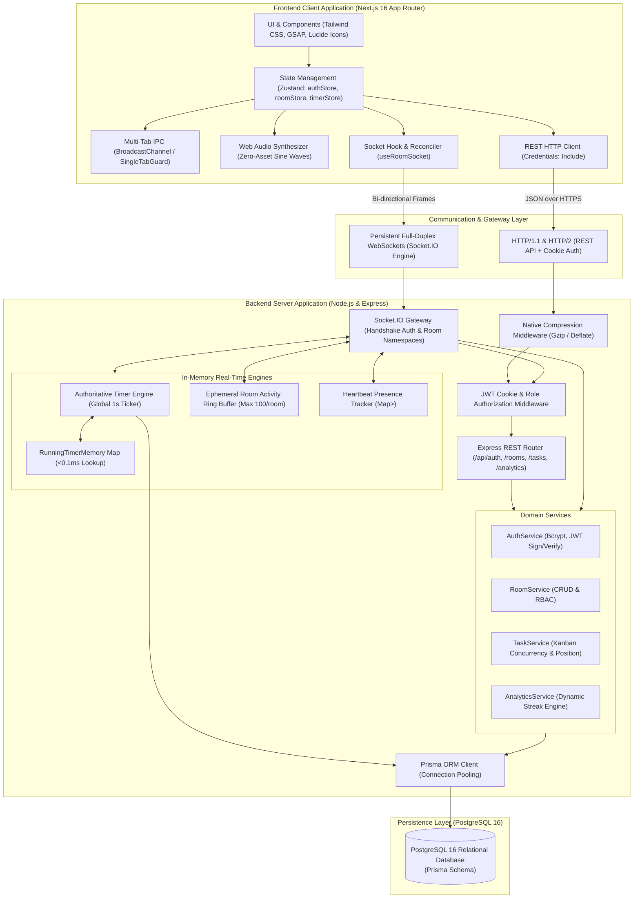
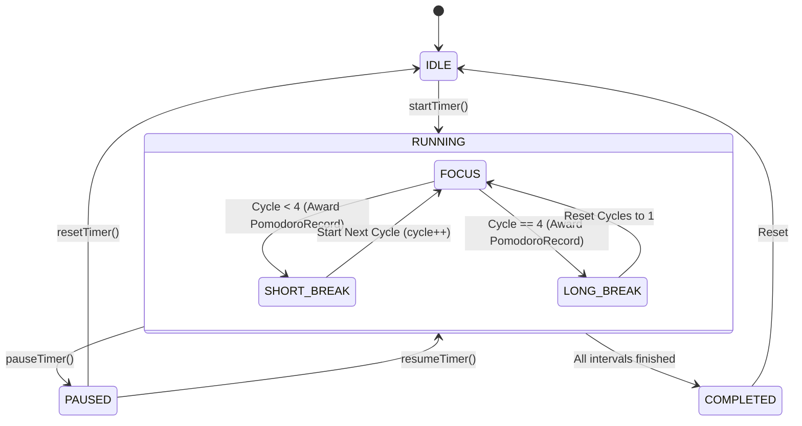

# Technical Architecture Documentation — StudyFlow

> **A High-Performance, Authoritative Real-Time Collaborative Workspace Architecture**

---

## 1. Architectural Vision & Executive Summary

StudyFlow is designed around a decoupled, monorepo architecture engineered to deliver authoritative, sub-50ms real-time state synchronization for distributed study groups. 

Unlike traditional single-player productivity tools that suffer from severe client-side timer drift, data desynchronization, and high database write pressure, StudyFlow employs a **hybrid communication model** paired with a **dual-tier storage strategy**:
- **Authoritative Server-Side State Machine:** The backend acts as the single source of truth for timer states and room orchestration, eliminating clock drift caused by device differences or browser tab sleep.
- **Dual-Tier State Model:** Mission-critical relational data (users, rooms, tasks, completed focus analytics) is persisted in **PostgreSQL 16 via Prisma ORM**, while high-frequency room interactions (live chat, presence heartbeats, activity feeds) stream through an **ephemeral in-memory ring-buffer in Node.js**.
- **Browser-Level Concurrency Control:** Implements a native `BroadcastChannel` protocol (`SingleTabGuard`) to prevent redundant WebSocket connections and audio conflicts across multiple open tabs.

---

## 2. High-Level System Architecture



---

## 3. Frontend Architecture (`apps/web`)

The frontend is constructed using **Next.js 16 (App Router)** and **React 19**, compiled in strict TypeScript mode.

### 3.1 Component & Layer Organization

```
apps/web/
├── app/                         # App Router File-System Routes
│   ├── layout.tsx               # Root layout: ThemeProvider, SingleTabGuard, Sonner Toaster
│   ├── page.tsx                 # Landing page with interactive live simulator & GSAP reveal
│   ├── login/ & register/       # Secure auth pages with one-click demo login presets
│   ├── dashboard/               # User hub: ongoing rooms, daily goals, recent stats
│   ├── rooms/                   # Study room list & creation modal
│   │   └── [id]/page.tsx        # Active study room: Pomodoro, Kanban, Chat, Presence
│   ├── tasks/                   # Standalone multi-workspace Kanban board
│   ├── analytics/               # Recharts data-driven productivity & streak analytics
│   ├── settings/                # User preferences (daily goals, themes, sound toggles)
│   ├── credits/                 # Academic attribution & defense criteria
│   └── admin/                   # Administrative overview & diagnostics
├── components/                  # Modular Presentation & Interactive Components
│   ├── timer/                   # PomodoroTimer, AstroTimer3D (visual focus progress)
│   ├── tasks/                   # WorkspaceKanban, TaskBoard, TaskCard, CreateTaskModal
│   ├── rooms/                   # ParticipantList, AstroRoomChatPanel, RoomInviteModal
│   ├── landing/                 # LandingHero, LandingFeatures, HowItWorks, LandingFooter
│   ├── layout/                  # Navbar, Sidebar, AppShell, SingleTabGuard, MobileNav
│   └── ui/                      # Button, Input, Modal, Badge, ThemeToggle, CommandPalette
├── hooks/                       # Custom React Hooks
│   ├── useRoomSocket.ts         # Central WebSocket lifecycle, events & state reconciliation
│   └── useTheme.ts              # System / Dark / Light theme synchronization
├── stores/                      # Zustand Reactive Client Stores
│   ├── authStore.ts             # User session, login, logout, profile state
│   ├── roomStore.ts             # Active room, participant list, Kanban tasks, chat activities
│   └── timerStore.ts            # Local timer ticks, authoritative state reconciliation
└── lib/                         # Core Utilities & Browser APIs
    ├── api.ts                   # Fetch wrapper with automatic credentials: include & 401 handling
    ├── socket.ts                # Socket.IO singleton factory with automatic reconnection
    ├── audio.ts                 # Web Audio API sine-wave completion chime synthesis
    ├── tabSync.ts               # BroadcastChannel multi-tab synchronization & guard
    └── confetti.ts              # Canvas confetti trigger for celebratory events
```

### 3.2 Reactive Store Architecture (Zustand)

StudyFlow utilizes [Zustand](https://github.com/pmndrs/zustand) for client state management due to its lightweight footprint (<1.5 KB), zero-boilerplate selectors, and outside-React dispatch capabilities:

1. **`authStore`**: Manages user authentication state (`user`, `isAuthenticated`, `isLoading`), profile mutations, and automatic session restoration via `/api/auth/me`.
2. **`roomStore`**: Houses active room metadata, participant rosters (with online status indicators), Kanban task arrays, and ephemeral activity items.
3. **`timerStore`**: Maintains the local timer presentation (`remainingSeconds`, `status`, `phase`, `currentCycle`). It decouples rapid 1-second visual countdowns from network latency while guaranteeing instant snapping when authoritative server packets arrive.

### 3.3 Multi-Tab Concurrency Guard (`SingleTabGuard`)

```mermaid
sequenceDiagram
    autonumber
    actor User
    participant TabA as Browser Tab A (Active)
    participant Channel as BroadcastChannel ("studyflow_tab_sync")
    participant TabB as Browser Tab B (Newly Opened)

    TabA->>Channel: postMessage({ type: "CLAIM_TAB", tabId: "tab_1" })
    Note over TabA: Tab A holds active lock
    User->>TabB: Opens StudyFlow in Tab B
    TabB->>Channel: postMessage({ type: "REQUEST_ACTIVE_TAB" })
    TabA->>Channel: postMessage({ type: "I_AM_ACTIVE", activeTabId: "tab_1" })
    TabB->>TabB: Detects another tab is active
    TabB->>User: Displays SingleTabGuard Modal ("StudyFlow is open in another tab")
    Note over TabB: Disables redundant Socket connection & audio
    User->>TabB: Clicks "Use StudyFlow Here"
    TabB->>Channel: postMessage({ type: "CLAIM_TAB", tabId: "tab_2" })
    TabA->>TabA: Receives claim; yields lock and displays guard modal
    TabB->>TabB: Connects socket and resumes full interactivity
```

- When multiple tabs are open to the same room, race conditions, audio echo, and duplicate socket overhead can occur.
- Using the browser's native `BroadcastChannel` API, StudyFlow ensures only one tab actively maintains the WebSocket connection and plays audio alerts.
- If the user switches tabs, a single click on *"Use StudyFlow Here"* atomically transfers the active session.

### 3.4 Web Audio API Harmonic Synthesis

Instead of requesting external `.mp3` assets over the network (which introduces latency or fails entirely under restricted network environments), StudyFlow generates harmonic chime frequencies natively using the **Web Audio API**:

```typescript
// Pure mathematical harmonic chime generation: C5 -> G5 -> C6
const ctx = new (window.AudioContext || (window as any).webkitAudioContext)();
const notes = [523.25, 659.25, 783.99, 1046.50]; // C Major Chord
notes.forEach((freq, idx) => {
  const osc = ctx.createOscillator();
  const gain = ctx.createGain();
  osc.type = 'sine';
  osc.frequency.setValueAtTime(freq, ctx.currentTime + idx * 0.12);
  gain.gain.setValueAtTime(0.2, ctx.currentTime + idx * 0.12);
  gain.gain.exponentialRampToValueAtTime(0.001, ctx.currentTime + idx * 0.12 + 0.8);
  osc.connect(gain);
  gain.connect(ctx.destination);
  osc.start(ctx.currentTime + idx * 0.12);
  osc.stop(ctx.currentTime + idx * 0.12 + 0.8);
});
```

---

## 4. Backend Architecture (`apps/server`)

The backend is built with **Node.js**, **Express.js**, **Socket.IO**, and **Prisma ORM**, strictly separating concerns into Controllers, Services, Middleware, and Sockets.

### 4.1 Server Layer Decomposition

```
apps/server/src/
├── config/                      # Environment schema validation (env.ts) & Prisma instance (prisma.ts)
├── controllers/                 # HTTP Request/Response handling & parameter parsing
│   ├── authController.ts        # Register, login, logout, me, refresh
│   ├── roomController.ts        # Create, list, join by code, update, delete
│   ├── taskController.ts        # REST task CRUD & batch reordering
│   └── analyticsController.ts   # User productivity summary, streaks & charts
├── middleware/                  # Request Pipeline Middleware
│   ├── auth.ts                  # JWT extraction from HTTP-only cookie + Bearer header
│   ├── compression.ts           # High-performance native Gzip/Deflate compression
│   ├── errorHandler.ts          # Normalized JSON error response formatter
│   └── validate.ts              # Zod schema request payload validation
├── routes/                      # Modular Express Router declarations
│   ├── authRoutes.ts, roomRoutes.ts, taskRoutes.ts, analyticsRoutes.ts
│   └── index.ts                 # Master /api router aggregation
├── services/                    # Core Business Logic & State Machines
│   ├── timerService.ts          # Central Authoritative Timer Engine & Global Ticker
│   ├── taskService.ts           # Collaborative task management & broadcast dispatch
│   ├── roomService.ts           # Room membership, invite codes & role validation
│   ├── analyticsService.ts      # Continuous streak calculation & aggregation queries
│   └── activityMemory.ts        # In-memory ephemeral chat & activity ring-buffer
├── sockets/                     # Real-Time Event Gateway
│   └── socketServer.ts          # Handshake authentication, room join/leave, event routing
├── shared/                      # Shared Contracts, DTOs, Enums, and Validators
└── __tests__/                   # Vitest unit, integration & multi-client concurrency tests
```

---

## 5. Authoritative Real-Time Synchronization Engine

The central architectural challenge of group study tools is ensuring that dozens of users scattered across different networks and devices stay synchronized to the exact same second.

### 5.1 The Mathematical Model of Non-Drifting Time

Traditional client timers calculate remaining time by executing `remaining = remaining - 1` every 1,000 milliseconds via `setInterval`. Because JavaScript timers on client devices are subject to thread blocking, background tab suspension, and clock drift, client-side timers diverge rapidly.

StudyFlow eliminates this through an **absolute time delta calculation**:

$$R(t) = \begin{cases} 
R_{saved} & \text{if } \text{status} = \text{PAUSED} \\
\max\left(0, R_{saved} - \lfloor \frac{t_{server} - t_{started}}{1000} \rfloor\right) & \text{if } \text{status} = \text{RUNNING} \\
D_{total} & \text{if } \text{status} = \text{IDLE}
\end{cases}$$

Where:
- $t_{server}$ is the current monotonic server clock timestamp (`Date.now()`).
- $t_{started}$ is the Unix millisecond timestamp when the timer was initiated or resumed.
- $R_{saved}$ is the base remaining seconds stored at the start or pause of the phase.
- $D_{total}$ is the total duration configured for the current phase (e.g., 1500s for Focus).

### 5.2 High-Throughput In-Memory Caching (`RunningTimerMemory`)

Running a database query every second for every active room would overwhelm PostgreSQL connection pools under load. StudyFlow implements an in-memory active timer cache:

```typescript
interface RunningTimerMemory {
  roomId: string;
  sessionId?: string | null;
  phase: TimerPhase;
  startedAt: number;              // Milliseconds
  baseRemainingSeconds: number;
  totalPhaseDuration: number;
  currentCycle: number;
}
```

1. **Start/Resume:** The state is persisted in PostgreSQL once, and a `RunningTimerMemory` record is stored in a Node.js `Map<string, RunningTimerMemory>`.
2. **Global 1-Second Ticker:** A single server-wide `setInterval` iterates through active rooms, computes $R(t)$ in memory (<0.01ms CPU time), and broadcasts `timer:tick` to the room's Socket.IO channel.
3. **Zero Database Reads during Active Ticking:** Read queries during active countdowns are $O(1)$ in-memory lookups, providing sub-millisecond response times.
4. **Pause/Completion:** The calculated state is written back to PostgreSQL, and the memory entry is evicted.

### 5.3 Automated Phase State Machine



- When $R(t)$ reaches 0, the server executes `handlePhaseCompletion(roomId)`.
- If the completed phase was `FOCUS`:
  - A `PomodoroRecord` is automatically inserted for every currently connected participant in the room.
  - The cycle counter increments. If `currentCycle >= cyclesBeforeLongBreak` (default 4), the next phase is `LONG_BREAK`; otherwise, `SHORT_BREAK`.
- The state machine updates the room record and immediately broadcasts `timer:phase-changed` to all clients.

---

## 6. Real-Time WebSocket Protocol & Event Schema

StudyFlow uses Socket.IO over persistent WebSockets with fallback to HTTP long-polling.

### 6.1 Authentication During Socket Handshake

Every incoming WebSocket connection must authenticate during the initial handshake:
1. The client sends either:
   - The HTTP-only `access_token` cookie (parsed via `parseCookie(socket.handshake.headers.cookie)`).
   - An explicit token in `socket.handshake.auth.token` or `Authorization: Bearer <token>`.
2. The middleware verifies the JWT against `env.JWT_SECRET`.
3. If valid, the user record is attached to `socket.data.user`. If invalid, the connection is immediately rejected.

### 6.2 Event Catalog

| Event Name | Direction | Payload | Description |
| :--- | :---: | :--- | :--- |
| `room:join` | Client $\to$ Server | `{ roomId: string }` | Joins the room namespace and requests full state. |
| `room:leave` | Client $\to$ Server | `{ roomId: string }` | Leaves the room namespace. |
| `room:state` | Server $\to$ Client | Full `StudyRoom` DTO | Authoritative initial state snapshot upon joining. |
| `room:participant-joined` | Server $\to$ Client | `{ user: SafeUser, roomId }` | Broadcast to peers when a new member joins. |
| `room:participant-left` | Server $\to$ Client | `{ userId, roomId }` | Broadcast to peers when a member disconnects. |
| `room:activity` | Server $\to$ Client | `RoomActivity` | Real-time chat message or audit feed event. |
| `room:send-message` | Client $\to$ Server | `{ roomId, message }` | Sends ephemeral live chat message to room. |
| `timer:start` | Client $\to$ Server | `{ roomId }` | Host/Mod command to begin countdown. |
| `timer:pause` | Client $\to$ Server | `{ roomId }` | Host/Mod command to pause countdown. |
| `timer:resume` | Client $\to$ Server | `{ roomId }` | Host/Mod command to resume countdown. |
| `timer:skip` | Client $\to$ Server | `{ roomId }` | Host/Mod command to skip to next phase. |
| `timer:tick` | Server $\to$ Client | `{ remainingSeconds, serverTimestamp }` | Broadcast every 1s to synchronize room clock. |
| `timer:state` | Server $\to$ Client | `AuthoritativeTimerState` | Emitted on start, pause, resume, reset. |
| `timer:phase-changed`| Server $\to$ Client | `{ previousPhase, newPhase, timerState }` | Emitted when countdown hits 0. |
| `task:create` | Client $\to$ Server | `CreateTaskInput` | Creates a new Kanban task card. |
| `task:created` | Server $\to$ Client | `Task` | Broadcasts newly created task to all peers. |
| `task:update` | Client $\to$ Server | `{ taskId, updates }` | Updates task title, status, or assignee. |
| `task:updated` | Server $\to$ Client | `Task` | Broadcasts modified task to all peers. |
| `task:delete` | Client $\to$ Server | `{ taskId, roomId }` | Deletes a task card. |
| `task:deleted` | Server $\to$ Client | `{ taskId, roomId }` | Broadcasts task deletion to all peers. |

---

## 7. Storage Architecture & Ephemeral vs Persistent Boundary

A key engineering decision in StudyFlow is the strict boundary between **persistent relational data** and **ephemeral session data**.

```
┌────────────────────────────────────────────────────────────────────────┐
│                        DATA PERSISTENCE STRATEGY                       │
├───────────────────────────────────┬────────────────────────────────────┤
│   PostgreSQL 16 via Prisma ORM    │      Node.js Ephemeral Memory      │
│   (Persistent Relational Data)    │      (High-Throughput / No IO)     │
├───────────────────────────────────┼────────────────────────────────────┤
│ • User Credentials & Profiles     │ • Live In-Room Chat Messages       │
│ • Study Rooms & Configurations    │ • Ephemeral Participant Join/Leaves│
│ • Room Memberships & Roles        │ • Live Timer Countdown Milliseconds│
│ • Collaborative Kanban Tasks      │ • Active Heartbeat Participant Map │
│ • Historical PomodoroRecords      │ • In-Memory Ring Buffer (100 msgs) │
│ • Study Session Logs              │ • Transient Toast Activity Alerts  │
└───────────────────────────────────┴────────────────────────────────────┘
```

### Why Ephemeral In-Memory Chat?
In high-frequency collaborative study sessions, students post casual remarks ("Starting Chapter 4", "BRB 2 mins", "Good job team!"). Writing every chat message to PostgreSQL creates high disk I/O, rapid table growth, and vacuum overhead.

By adopting the **Google Meet / Zoom model**, chat and transient activity exist purely in an in-memory ring-buffer (`RoomActivityService`) capped at 100 entries per room. When the study session ends, the memory is released. This guarantees:
- **Zero database write pressure** from chat bursts.
- **Sub-millisecond broadcast latency.**
- **Privacy by design:** Casual study room conversations are not permanently stored on disk.

---

## 8. Security & Authorization Architecture

StudyFlow implements defense-in-depth across the entire full-stack lifecycle:

### 8.1 Cookie-Based Authentication
- Tokens are issued as signed **JSON Web Tokens (JWT)**.
- Stored exclusively in **HTTP-only, SameSite=Lax** cookies (`access_token`).
- **XSS Immunity:** JavaScript code running in the browser cannot read or exfiltrate the token via `document.cookie`.
- **CORS & CSRF Hardening:** Express configures strict CORS origins with `credentials: true`. State-changing REST requests are protected against Cross-Site Request Forgery.

### 8.2 Cryptographic Password Hashing
- User passwords are automatically salted and hashed using **bcryptjs** with 10 salt rounds:
  $$\text{Hash} = \text{bcrypt}(\text{password}, 10)$$
- Plaintext passwords are never logged, stored in cache, or returned in database queries.

### 8.3 Role-Based Access Control (RBAC) Enforcement
Every action within a study room is governed by the user's role in the `RoomMember` table:

| Action | Room Owner | Room Moderator | Room Member |
| :--- | :---: | :---: | :---: |
| Modify Room Settings & Durations | ✅ | ❌ | ❌ |
| Delete Study Room | ✅ | ❌ | ❌ |
| Start, Pause, Resume, Skip Timer | ✅ | ✅ | ❌ |
| Assign / Promote Member Roles | ✅ | ❌ | ❌ |
| Remove Members from Room | ✅ | ✅ | ❌ |
| Create & Move Kanban Tasks | ✅ | ✅ | ✅ |
| Delete Others' Tasks | ✅ | ✅ | ❌ |
| Send Real-Time Chat & View Roster | ✅ | ✅ | ✅ |

Authorization is enforced at both the **REST controller level** and the **WebSocket event handler level**—preventing rogue clients from emitting unauthorized socket events.

---

## 9. Performance & Optimization Strategy

1. **Native Response Compression:** Integrated custom compression middleware using Node's native `zlib` stream pipeline, serving Gzip and Deflate compression for all responses exceeding 1 KB without external runtime dependencies.
2. **Conditional HTTP Caching:** Configured standard `Cache-Control: private, no-cache, stale-while-revalidate=30` headers, enabling instant 304 Not Modified responses for repeated read requests.
3. **Database Connection Pooling:** Configured Prisma Client with Supabase connection pooling support (PgBouncer mode) to safely handle concurrent socket connections without exhausting database connection limits.
4. **Client-Side Asset Optimization:** Zero external audio dependencies via Web Audio API, SVG icons via Lucide, and optimized Next.js 16 build bundles.

---

## 10. Automated Testing Architecture

The codebase is validated by automated test suites executed via **Vitest**:

```bash
npm test
```

### Test Coverage Suites:
1. **`timer.test.ts`**: Verifies authoritative mathematical formulas, drift elimination, pause duration preservation, and 4-cycle Pomodoro state transitions.
2. **`auth.test.ts`**: Validates bcrypt password hashing, JWT generation, expired token rejection, and sanitized user data serialization.
3. **`concurrency.test.ts`**: Simulates multiple simultaneous Socket.IO client connections in parallel, asserting sub-50ms timer synchronization and real-time task broadcasts.
4. **`socketActivity.test.ts`**: Tests the in-memory ring buffer, verifying that room activity never exceeds 100 items and preserves memory limits.
5. **`compression.test.ts` & `clientCache.test.ts`**: Asserts Gzip response compression and HTTP 304 conditional cache headers.
6. **`tabSync.test.ts`**: Tests multi-tab lock acquisition and arbitration logic.
